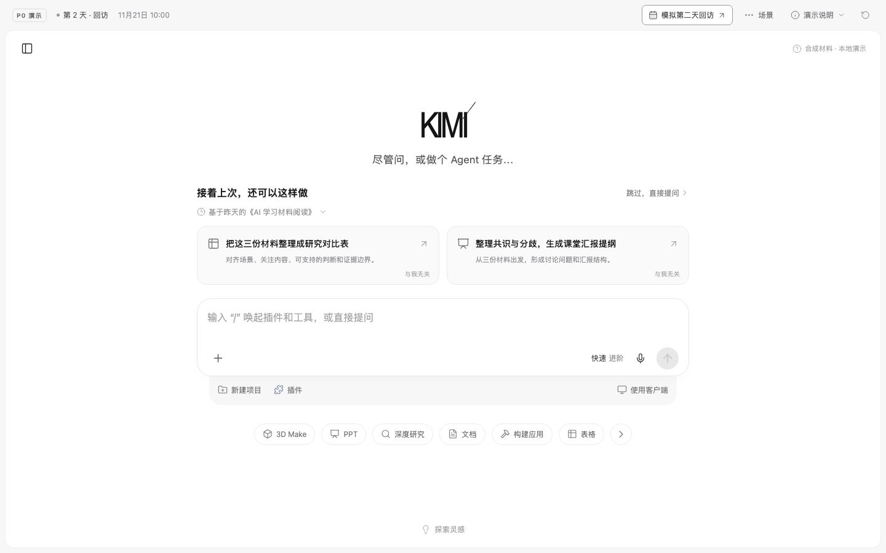

# Kimi P0 · 首周回访的历史任务延伸建议

这是用于 Kimi AI 产品经理岗位笔试的可交互网页原型。只实现 P0，不实现会员购买链路。

**核心体验：**一次基础使用留下线索 → 两次访问之间准备建议 → 回访发现下一步价值 → 核对已有上下文 → 获得可用于课堂汇报的新产物。

## Demo 与截图

- [观看 68 秒主流程录屏（MP4）](public/demo/main-flow.mp4)
- [首次使用](delivery/01-first-visit.png) · [回访建议](delivery/03-revisit-suggestions.png) · [材料确认](delivery/05-confirm-materials.png) · [对比表产物](delivery/06-comparison-result.png) · [手机界面](delivery/08-mobile-revisit.png)
- [完整实际验证记录](delivery/验证记录.md)
- 本地运行后，打开 `/demo.html` 可播放内嵌录屏，并直接进入交互原型。



视觉参考上传的 Kimi 主端截图，保留黑白灰聊天布局、大圆角输入框、附件加号、快速/进阶、麦克风、向上发送按钮、工具托盘和胶囊功能入口。首页保留官网落地文案“尽管问，或做个 Agent 任务…”；品牌采用纯文字标识，不使用仿冒官方图像。

## 立即体验

- **无需安装：**在浏览器中打开 `dist/index.html`，可离线使用。它是包含全部脚本、样式和图标的单文件。
- **本机开发预览：**`http://localhost:5173/`（开发服务运行期间可访问）。
- 不需要账号、模型密钥、数据库或其他服务。所有材料都是合成演示素材。
- 静态版与开发版使用各自浏览器来源下的本地状态；二者的进度不会自动互通。

## 开发启动

在本项目目录中执行，建议使用 Node.js 20.19+ 或 22.12+：

```bash
npm ci
npm run dev
```

构建与预览：

```bash
npm run build
npm run preview
```

构建输出为 `dist/index.html`，并包括 `demo.html` 与录屏文件。预览端口为 `4173`。Vercel 构建设置已写入 `vercel.json`；发布后将在这里补充实际验证的公网地址。

## Vercel 部署

在 Vercel 导入本仓库，项目类型选择 **Vite**；构建命令 `npm run build`，输出目录 `dist`。无需环境变量或模型密钥。

GitHub Actions 在每次推送和 Pull Request 时检查 TypeScript、构建站点并保存静态站点 artifact。Vercel 若关联此 GitHub 仓库，可自动部署后续 main 更新。

## 主演示流程

1. 默认进入注册第一天。三份合成课堂材料与首次请求已经预置，可点击材料查看、编辑请求后发送。
2. 得到材料 A 的摘要与证据边界。首轮不会出现延伸建议或营销提示。
3. 首轮完成后，本地候选作业由 `pending` 进入 `ready`，缓存两条建议。通常约 1.5 秒，可在“演示说明”核对状态。
4. 点击产品画面外的“模拟第二天回访”。时钟前进 24 小时，读取前一步缓存；如果过早回访，输入框仍立即可用，候选不会后来突然插入。
5. 回访首页保留欢迎语，增加“接着上次，还可以这样做”。可展开来源、跳过、反馈“与我无关”，或直接发送新问题。
6. 选择建议后，核对已带入的材料和请求。可以编辑、移除材料，再点击“开始整理”。
7. 第一条生成研究对比表；第二条生成课堂汇报提纲。结果可真实复制和导出 Markdown，支持返回首页与查看演示历史。

`delivery/` 中有 10 张关键页面截图、68 秒主流程 MP4 录屏（无旁白）与示例 Markdown 产物。录屏中的停留时间用于阅读，不代表产品性能。

## 演示控制

| 控件 | 行为 |
|---|---|
| 模拟第二天回访 | 每次推进 24 小时，创建新的访问，读取已有候选 |
| 场景 → 初次使用 | 重置本原型，回到第一天 |
| 场景 → 直接体验回访 | 载入明确标注的示例材料历史；不伪造首轮提交、结果完成等先前事件 |
| 场景 → 无匹配历史 | 载入旅行规划历史，不显示课堂材料建议 |
| 场景 → 候选延迟 | 候选约 12 秒后可用；当前页不插入，下次进入首页才读取 |
| 场景 → 候选生成失败 | 建议降级为空，普通提问可用；演示说明中可重新准备 |
| 场景 → 下一次任务失败 | 下一次确认的任务失败，保留原问题，可重新整理 |
| 场景 → 超过首周 | 模拟第九天，不展示首周建议 |
| 演示说明 → 移除源材料 C / 修改源版本 | 增加来源 revision，旧候选变为 `stale`；确认区必须重新校验 |
| 演示说明 → 重新准备候选 | 基于当前来源和材料重新生成，之后重新进入首页查看 |
| 重置 | 只清除本原型独立存储，不清理其他应用的数据 |

## 已实现的交互与状态

- 导航展开/折叠，实际合成会话列表和搜索，首页/确认区/会话切换。
- 中文文本编辑、Enter 发送、Shift+Enter 换行；组合输入事件有防误发保护。
- 材料预览、添加/移除已预置材料、编辑请求、提交前来源与版本校验。
- 用户任务区分未开始（已预填，尚未提交）、执行中、成功、失败、用户取消；输出期间可停止。
- 两种不同且可读的产物。对比表覆盖场景、关注内容、记录、判断、证据边界、不能推出的结论，以及“未提供”的方法/数据。
- 跳过按当前访问保存；拒绝按来源与任务类型抑制，来源版本更新后仍保持。
- 延迟/失败不拦截输入；候选准备好不抢占已经开始输入的页面。
- 来源删除会失效；确认前再次校验；执行中移除源材料会中止，重试只使用当前有效材料。
- 普通新问题保持原文。超出演示支持范围时说明能力边界，不假装通用模型回答。
- 浏览器本地恢复会话、草稿、候选版本、跳过/拒绝和任务状态。
- `pending` 保存真实 `dueAt`，刷新后通过同一完成逻辑恢复；不会永久卡在准备中。
- 弹层可关闭、Escape 返回、焦点约束；清楚的按钮禁用/执行状态。
- 手机纵向任务气泡、表格横向滚动；输入区在结果内容之后，保证长结果不被压住。
- 真实复制、文件下载和反馈。次要主端能力入口仅提供可关闭的简短说明。

## 策略模拟范围

`src/materials.ts` 是唯一材料内容来源。来源历史保存材料标识、目标摘要和 revision；候选与结果都读取同一份内容。

候选仅对首周内、已经回访且有合适材料阅读历史的人展示，材料至少两份。候选记录来源会话、revision、材料版本和生成时刻；回访按钮不临时生成推荐文案。

摘要、对比表和提纲由确定性模板生成，编辑请求通过限定的意图规则区分材料摘要、对比与提纲。任意新增指令不会像通用模型一样获得完整理解与执行；超出支持的任务类型会如实说明。缺失的方法与数据不会补编。

异步作业仅在页面存在时由浏览器计时器推进。关闭页面或电脑后不会继续运行；再次打开时根据保存的时间与当前有效来源恢复。没有云端异步服务。

本地事件仅记录实际曝光、点击、跳过/拒绝、确认提交、结果完成、取消/失败，以及复制导出。预填没有记成执行，点击没有记成结果完成；示例历史加载也没有补造过去的操作。事件可在演示说明中查看和导出。

独立存储键：`kimi-p0-prototype:v1`。注册时间与演示当前时间使用合成时钟；候选的等待/恢复使用真实墙钟时间。

## 实际验证

已用 Playwright 驱动 Chromium 实际操作，综合 **24 项场景通过**。对修正的按钮名称、版本校验和长页布局做了针对性复核；最后一批主流程与布局检查 **8/8 通过**。`npm run build` 通过，未捕获的 JavaScript 错误为 0。

覆盖首次摘要、第二天缓存、两个不同产物、来源预览、编辑与材料移除、复制与真实下载、跳过/拒绝、无匹配历史、候选延迟/失败、来源版本失效、执行中源材料删除、任务失败/取消及重试、刷新恢复、独立重置与首周限制。详见 `delivery/验证记录.md`。

已检查 1440×900、1280×800、1024×768、768×1024、390×844、320×740 的布局，没有页面横向溢出；手机表格在自身区域横向滚动。已另外跑通 `file://` 单文件静态版的完整两次访问、建议选择、移除 C、生成 A/B 对比表、真实 Markdown 下载与刷新恢复。

没有验证真实 Safari/Firefox、手机系统键盘或真实用户增长效果。

## 未实现内容

真实 Kimi 模型、通用问答、任意文件解析、语音识别、真实插件/项目/客户端、注册登录、P1/P2、会员页与交易、云端后台、跨设备同步和线上实验。没有证明会员转化提升或 D7 留存不下降。

这份作品用于验证交互与产品因果：基础摘要留下线索，回访发现下一步，确认后减少背景重述，得到可用于课堂汇报的新产物。实际转化和留存效果仍须线上实验验证。

## 代码位置

```text
src/materials.ts   合成材料与请求
src/state.ts       来源、候选作业、访问与任务状态、本地事件
src/results.tsx    与同一材料对应的页面产物和 Markdown
src/App.tsx        共享界面与交互
src/styles.css    Kimi 风格、布局与响应式
dist/index.html   可离线打开的单文件版本
public/demo.html  录屏播放页
public/demo/      网页使用的 MP4 演示视频
delivery/         截图、视频、示例产物与验证记录
```
